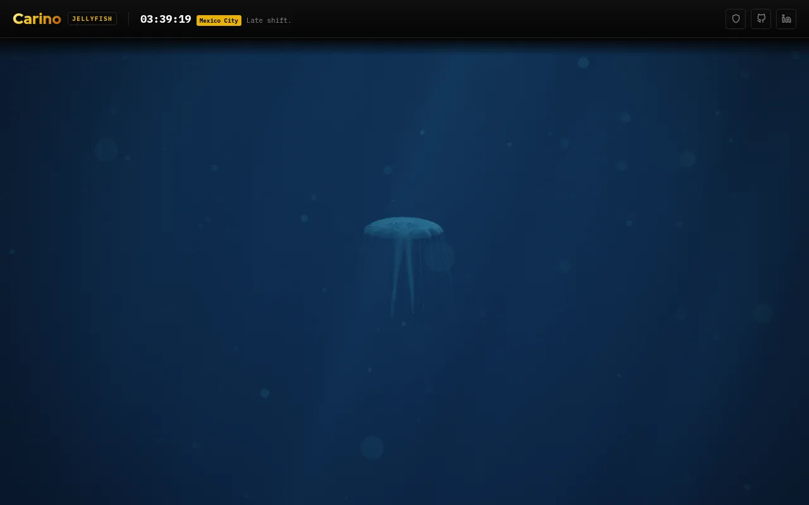

# Jellyfish
One ambient WebGL2 page — a moon jelly, swimming

Part of [Carino Systems](https://carino.systems). Live at **jellyfish.carino.systems**.



A single *Aurelia aurita* at 14 m depth, drifting in open blue water. Nothing is
drawn on screen but the water and the animal: no readout, no title card, no
counter, no control. Three unlabelled keys choose between three ways of watching
it, and for the first nine seconds of a session one line of grey text near the
bottom of the frame names them and then goes and does not come back. After that
the document is one element and one child again, and the page is complete
without ever pressing a key. It is built to be opened on a second monitor and
left there.

## What it is

- **A whole animal, simulated.** The bell is a closed two-shell surface of
  revolution with a scalloped 16-lappet margin. It contracts fast and recoils
  slowly, and the recoil is deliberately under-damped, so the bell flares about
  8 % past rest before it settles. The contraction travels from the crown to the
  margin, arriving a fifth of a cycle later — the margin always lags.
- **It swims because it pushes water.** Thrust is integrated from the contraction
  rate against quadratic drag, never keyframed, so the animal surges, coasts,
  sinks a little and surges again. Each contraction sheds a vortex ring; the
  tentacles get caught and flicked by it during the glide.
- **Forty tentacles and four oral arms**, run as verlet chains against a
  curl-noise current, with distance and bend constraints at 120 Hz.
- **It never repeats.** The beat period wanders on a 96 s carrier with a
  mean-reverting jitter, and a Poisson process skips or doubles the occasional
  stroke, as a real medusa does when correcting course. The camera drifts on a
  Lissajous path of 59 / 83 / 127 s — mutually near-irrational, so the framing
  does not come back around within any plausible sitting.

## How it renders

Eight passes, forward, HDR-linear throughout, at an absolute pixel budget rather
than a fixed resolution.

**The blue is derived, not painted.** There is not one hard-coded blue anywhere
in the render path. The sun is scene-referred and essentially white; every colour
on screen is what survives per-channel absorption through sea water, and the
depth gradient is the in-scatter integral rather than an artist's ramp. Zeroing
the red absorption coefficient visibly reddens the animal, which is the test.

**The jelly is lit by its own thickness.** A signed additive buffer accumulates
optical depth along the view ray through every layer of tissue at once — both
walls of the bell, an arm folded underneath, a tentacle behind — encoded relative
to the bell's front depth so that a centimetre of wall is hundreds of ulps of
fp16 instead of three. Tissue density is a pattern, not a constant: the coronal muscle ring,
sixteen radial canals and four gonad horseshoes all sum into it, so they show
*through* the bell exactly as they do in a photograph. The luminous rim is that
integral at grazing incidence, not a Fresnel term; a real jellyfish has almost no
Fresnel reflection, which is precisely why it is nearly invisible in water.

**The near shell composites the scene through itself.** Whichever half of the
bell is facing the camera — the exumbrella from above, the subumbrella when the
orbit swings underneath — is drawn last and refracts the water column behind it
with a real march distance and a touch of Cauchy dispersion, so the far shell,
the gonads and the far tentacles are not merely occluded by the bell: they are
tinted, dimmed and bent by it.

**One caustic texture lights everything.** The godray march, the ripple crawling
over the bell and the twinkle on a passing snow mote are the same fetch, so they
cannot disagree. Marine snow runs in three strata with real circle-of-confusion
arithmetic; the near stratum's sprite *is* the bokeh, which is why there is no
depth-of-field pass anywhere in the renderer.

**The post chain is photographic.** Sensor shot and read noise are injected in
linear HDR before the transfer curve, then AgX, which desaturates toward white on
rolloff instead of clipping to neon cyan. Auto-exposure is clamped to ±0.25 EV,
tighter than a game's, because a brightness pump in peripheral vision at 3 am is
the thing that makes an ambient page unwatchable. Triangular-PDF dither is
non-negotiable: a near-black blue ramp on an 8-bit panel bands catastrophically.

**Calm is a shipping requirement.** The quality ladder is invisible by
construction — the shaft march uses closed-form segment integration, so halving
the step count changes sharpness and never brightness, and the tentacle count is
fixed at forty in every tier, forever. Nothing in the frame should be nameable
while you are looking at it.

`prefers-reduced-motion: reduce` freezes the swim cycle mid-relaxation with the
arms streaming, drops the strands to a stateless retarded-time sway and stops the
camera, but leaves the grain, dither and exposure alive. A still image, not a
dead one.

## Where this departs from SPEC.md

`SPEC.md` is the build spec, and it is authoritative about intent. These are the
places the shipped renderer disagrees with its numbers, every one of them
because the frame measured wrong against the spec's own acceptance checks.

| Subject | Spec | Ships | Why |
| --- | --- | --- | --- |
| Ambient in-scatter | a flat `0.75` in place of a phase function | `hg(0, 0.62) = 0.030` | The veil is a radiance, and the shafts, the snow and the animal are all lit from `downwelling()` directly. At 0.75 the water was twenty five times too bright and everything in the frame sat a few per cent above it. |
| Post chain | no scene-referred exposure | `SCENE_EXPOSURE`, on `hdrDecode` | `SUN_E0` is scene-referred and AgX puts middle grey at 0.18, so the column arrived several stops into the shoulder and landed near white. |
| Mesoglea | `WALL_A` 0.058 R, `SIG_S_G` (14, 16.5, 19) | 0.120 R, (22, 26, 30) | 7.5 mm over the apex of a 26 cm animal scattered under nine per cent of the light reaching it. §5.5's anchors put the lit bell three to four times above the column; this is what gets it there. |
| Passes 5 and 6 | subumbrella, then exumbrella | far shell, then near shell | The orbit spends long stretches below the animal, and the pinned version culled every visible triangle of the shell facing the eye. |
| Oral arms | 0.9 R wide, one strand shader | 0.42 R, plus a coverage term and their own ribbon plane | The shader read a ribbon's width as its depth, so the arms rasterised as opaque camera-facing sails in front of the bell. |
| Camera | 1.9–3.2 m orbit, aimed at the animal | 1.3–2.2 m, each spring leads by `2*tau`, and the aim sits one bell radius low | A 26 cm animal at 2.55 m is 15 % of the frame height. `springStep` is second order, so a spring following a swimmer trails it by `2*v*tau`: at one tau of lead 0.41 m survived, 16.8° of a 19° half-frame, and the bell crossed the bottom edge. The aim is dropped because the animal is bell plus a fringe reaching 0.20 m below the bell centre in the mean and 0.47 m at worst, which was off the bottom edge in 3.6 % of frames. |
| Marine snow | §5.4's counts, focus at 6 m | mid and near counts divided by the frustum's solid-angle fraction, focus on the animal | The counts are seeded over a full sphere, of which a 38° lens sees 5.7 %: three near motes reached the screen, thirty pixels out of focus. |
| Bell multiple scattering | `alb · (1−Tr) · wrap(N,L) · uSunCol · shadowG` | the same divided by π, with a two-sided lobe | `uSunCol` is an irradiance and `ms` is the radiance leaving the tissue, so the diffuse lobe carries the 1/π every diffuse BRDF carries — it was the last term in the project converting one to the other by hand. That alone drops the lit dome 32 % and the margin 25 % while the refracted background under them does not move, which is what turns the bell from a lit cap into glass. The lobe is then mixed toward the mean of the near and far wrap by the scattered fraction `1 − Tr`, because multiply scattered light has forgotten where the sun was: the plain wrap returns exactly zero more than 0.65 away from the light, and the gonads and canals hang under a bell lit from above, so every dense structure in the animal had no key light at all and rendered darker than the water behind it. |
| Exumbrella composite | `waterApply(col + bg·Tr)` | `waterApply(col) + (bg − haze)·Tr` | The SEA tap is a render from this same eye, so it already carries the water between the animal and the camera; fogging the sum applies that stretch twice. The two agree wherever the background equals the veil, which is how it survived, but every shaft and every mote behind the bell lost `exp(−SIG_T_W·dist)` of its contrast and the thinnest margin stamped a step into the water behind it. |
| Ambient water dome | `… · alb · (1 − Tr) · 0.6` | the 0.6 dropped | An occlusion guess that put dense tissue below the medium it displaces. Mesoglea is sea water with a little collagen in it, single-scattering albedo 0.98, so a slab thick enough to hide the water behind it returns very nearly what that water was sending and cannot return 60 % of it. |
| Sensor chroma noise | `c.rb += gaussIGN(fragCoord · 0.25, …) · 0.0030` | `c.rb += gaussIGN(fragCoord.yx, …) · sigma · 1.0` | `ign()` is a low-discrepancy sequence over pixel coordinates, so quartering its argument does not reach for the demosaic's correlation length — it makes the field smooth. Measured, it carried +0.91 autocorrelation at lag (1,1): a four-pixel blob field over r and b that read as canvas weave in open water. Swapping the lanes gives the luma tap's own structure transposed at −0.03 correlation with it, and riding the shot-plus-read sigma makes the chroma track the signal instead of sitting at an absolute tuned for one exposure. |
| Marine snow compositing | `fragColor = vec4(colour · a, a)` with `a` unbounded | the alpha clamped to 1, and albedo scaling only the sunlit term | `SNOW_SOFT_NORM` renormalises the smooth kernel to the sprite's mean so the crossfade costs sharpness and never brightness, which puts its peak at 2.3. Handed to a premultiplied blender as an alpha that makes the destination term −1.3, and the frame's darkest pixels were marine snow rendering as holes — about twenty black dots per frame on the float path. A floc is a water-logged aggregate that displaces sea water, so it also cannot send the eye less than the water standing in its place. |
| Bell optical depth | §2.4's THICK.R, the density-weighted signed sum | `rho · THICK.G`, the fragment's own density on the exact geometric path | The R channel telescopes only when the two faces of a crossing report the same `rho`, and `density()` is a map of the anatomy: an oblique ray enters a wall at one (phi, theta) and leaves at another. What survives a pair is `(rho_out − rho_in) · d_in`, and for the FAR wall `d_in` is the whole body depth — a mismatch of one lands an error of 0.16 m on an optical depth whose true value is 0.05. Traced against the exact integral over 632 rays it carried 51 % mean absolute error and went NEGATIVE wherever a dense feature fell on the far subumbrella, at which point the `max(…, 0)` clamped it away and the animal was simply absent at that pixel. That is what the dark slots inside the dome were. The G channel carries no density, so it telescopes unconditionally; `rho · G` traces at 7 % error, 1 % bias, no negatives. |
| Strand ambient | §2.6's `inscatter(vWorldY) * 0.5` | the veil undiminished | The same slip the bell's ambient dome had in its 0.6: a strand's cross-section is its opacity, so at the spine the ribbon replaces the column behind it outright, and gel cannot return half the radiance of the water standing in its place. Every tentacle crossing the bell was stamping a line 52 % below the tissue around it. |
| Marine snow key light | `downwelling · causticAt(p) · phase` | the caustic mixed in at 0.6 | A mote samples the gobo at a POINT while the shaft behind it is that same field integrated along the whole ray, so a mote landing in a ridged-noise null lost its entire key and fell below the lit water behind it — seven motes a frame at up to 46 % of their background, which reads as a hole. The caustic modulates the direct beam, not the diffuse field that carries most of the light at 14 m, so a null cannot take the key to zero. |
| Inline shaft jitter | §2.2's `ign()` on both march paths | `hash12()` on the inline path only | The buffered path filters that jitter twice — a temporal blend against `uHistory` and a bilateral upsample — so `ign()`'s low discrepancy buys sample coverage and its structure never reaches the frame. Inline there is neither filter, eight steps land raw, and a low-discrepancy sequence left raw is a lattice rather than grain. Tier 4's 0.83 render scale then beat it against the pixel grid: 4.01 LSB of high-frequency residual in open water against 1.25 at tier 1, read as canvas weave. Same variance from `hash12()`, no lattice, shafts still unbanded. |

Everything else is the spec as written, including the parts that are easy to
mistake for bugs: the ±0.25 EV exposure clamp, the fixed forty tentacles, the
2.5 caustic softening exponent, and the fact that nothing in the render path
contains a blue constant.

## Where this goes beyond SPEC.md

The table above is a record of disagreement: the places where the shipped
renderer contradicts the spec's *numbers*, every one of them because the frame
measured wrong against the spec's own acceptance checks. What follows is
different in kind. These are deliberate additions of intent, and they are kept
out of that table on purpose — a departure is a correction, and this is not one.

**Three ways of watching.** Key `1` selects **tank framing**, which is what the
page boots into. Key `2` selects **free view**, the subject orbit §4.5
describes and the one this project shipped first. Key `3` selects **close
framing**, the subject-anchored orbit described two entries below. `?mode=tank`,
`?mode=free` and `?mode=close` are the boot overrides, alongside `?dev=1` and
`?tier=N`, and `app.setMode()` on the module handle is the programmatic
equivalent. Almost nothing is drawn for them: no badge, no toast, no title
change, no cursor change, and the only readout any of them gets is two lines
inside that same `?dev=1` panel. The exception is new, and it is the price of
the third key — for the first 8.7 s of a session one line of text names all
three framings and is then removed from the document, which §9's second
amendment licenses and bounds and which "One visible thing" below describes in
full. Everything else about this shape of affordance is what the spec already
licenses: `?dev=1` exists and "is never rendered otherwise". Hidden affordances
are permitted; persistent visible chrome still is not.

**What "tank" means, and what it does not.** §5.1 uses the phrase "reads as an
aquarium tank" as the *name of a rendering defect*: using `Kd` for beam
transmittance, which under-hazes the far field and flattens contrast with
distance. Tank framing is not that and does not reinstate it. It is a bounded
swim volume seen from a fixed observation point, and nothing new is drawn to
make it — no glass, no panes, no floor, no back wall, no corner seam.
`SIG_T_W` and `KD` are untouched, the medium still saturates to its far-field
value at about 28 m, and §5.2's "there is no visible back wall at any camera
angle" holds verbatim, because there is still nothing there to see.

**A third way of watching.** Key `3` is **close framing**: a subject-anchored
orbit 1.35 ± 0.15 m from the animal on a 30° lens, 6°–14° below it, standing on
the far side of it from the sun. It is not a second station and could not be
one — `sim/director.js` asserts `STATION_RADIUS ≥ TANK_HARD_RADIUS +
STATION_STANDOFF` and throws at boot, so a station at 1.35 m would demand a hard
tank radius of 0.70 m against the 2.05 m that ships; and the station's own lens
keep-out steers the animal directly *away* whenever it comes within 2.00 m and
saturates at 1.35 m — the close rig's own radius — so a near station would be
repelling the very animal it exists to be close to, every frame. Anchored to the
animal instead, the tank, the standoff and the keep-out simply never notice it,
and nothing in `js/render/` or `js/shaders/` knows that a framing exists at all:
no new program, no new uniform, no new target, no per-mode quality, no
mode-dependent physics.

Most of what the mode buys is the water it removes. Every shader ends in
`waterApply(c, dist, y)`, and across the station's median 3.10 m the animal's
own light arrives at (0.176, 0.490, 0.590) of what left it — 41 % of its blue
already replaced by flat, structureless in-scatter before it reaches the eye. At
1.35 m that is (0.470, 0.733, 0.795) and 20 %. Everything that reads as glass —
the optical-depth ramp down the margin, the canals, the horseshoes, the
refracted background — is a *contrast*, and the veil is what destroys contrast.
It is the same red-to-blue argument tank framing is built on, run in the other
direction and over a shorter path.

The rest is where the camera stands. The sun sits at 72°, so putting the eye
below the animal and on the far side of it from the sun fires four
already-shipped Henyey–Greenstein lobes at once, for no shader work whatever:
measured against a side-lit stance, the bell's single-scattering term runs
×2.29, the tentacle and oral-arm curtain ×2.04, the shaft field *behind* the
animal ×2.16 — permanently at its bright end — and the near bokeh between lens
and animal ×1.84. A glowing curtain against bright shafts, seen through a bell
that transmits three quarters of what is behind it, is the moon-jelly
photograph. The phase cap over that first lobe never comes near firing, which is
worth recording because the comment beside it said the opposite for a long time:
`hg(1, 0.72) = 1.746` against a cap of 2.4, so at the shipped anisotropy the cap
is unreachable at *every* geometry. It was sized for the `g = 0.86` of an
earlier build, where the same expression reaches 7.55. The best angle the 25°
look-elevation limit allows is `hg = 0.055`, three per cent of the theoretical
peak, so §4.5's forward-scatter flare is geometrically unreachable from this rig
rather than merely bounded.

Two things about that placement are worth writing down. First, the bearing is
locked to the sun's azimuth and the sun's azimuth laps every six minutes
(`SUN_AZIMUTH_PERIOD = 360 s`), so the close rig orbits the animal once per six
minutes. That is accepted rather than avoided. It introduces no new carrier — it
rides one the page has always had, and one outside §10's forbidden 20–300 s band
by a minute. It holds the lighting stance fixed *in camera space*: the shaft
lean, the caustic key on the bell and the whole staging are frozen, which is the
calmest lighting this page can have and permanently the good light, where
latching the bearing at entry would put the sun on the wrong side within three
minutes. What it sweeps through is landmark-free, because the snow strata are
bands around the camera and travel with it, the water column is isotropic and
the shaft field is statistically so. And the speed is one the page already
produces: 23.6 mm/s of tangential eye motion, within 6 % of the 22.4 mm/s the
shipped subject rig reaches at its own peak azimuthal rate, and a hundred times
under the per-frame displacement at which `shaders/shafts.js` rejects its
history. Entering the mode plants a bias that puts the commanded bearing exactly
where the camera already is, so the switch is a radial dolly rather than a sweep
across the snow strata; the bias then decays on a 150 s exponential, so the shot
arrives and then, over five to eight minutes, finds its light.

Second, the rim cannot get brighter, and that is provable rather than promised.
The multiple-scattering term that makes the margin is `alb · (1 − Tr) · lobe`
with the lobe built from `wrapDiffuse(N, L, 0.65)`: it depends on `N·L` and
never on `V`, so no camera placement anywhere can walk §5.5's `#B9D9EE` anchor
toward AgX's `#E8F2F8` clip ceiling. Backlighting raises the *interior* — the
single-scattering term, the one that carries `Tr` — and leaves the margin
exactly where it was measured. That is the calmest guarantee this mode could
have, and it is the reason no density weight, no `F0` and no roughness moved for
it.

The close rig is a *wider* lens moved closer, not a longer one held back. A 9°
lens at the existing 3.10 m station gives the same subtense and breaks no
assertion at all, and it is worthless: no lens removes the water in the
intervening path. Narrowing the lens also makes the foreground worse rather than
better, because `uCocScale` is FOV-independent while a mote's geometric size
scales as `1/tan(halfFov)` — a narrower lens grows every foreground floc while
leaving its circle of confusion fixed in pixels, and drives coverage toward a
fully opaque 96 px disc painted over the animal with the depth test off.
Measured for a 6 mm floc at 0.4 m at 1080p: coverage 0.575 in shipped tank
framing, 0.496 in close, 0.792 at 24°, 1.000 at 18°. The close-up's foreground
is *less* obtrusive than the one that already ships. 30° also keeps §5.3's three
or four shaft columns across the frame, and it is the first framing in which the
plane of focus lands on the animal rather than on its 1.0 m clamp, so the near
stratum reads as real macro defocus and the motes in the animal's own plane are
razor sharp.

Two things were checked and found not to need doing. The silhouette does not
facet: at close framing's 217 px projected bell radius, against tank framing's
102 px, the chord sagitta of LOD0's 160-segment polygon is 0.048 px, so there is
no finer LOD in this repository and there does not need to be. And the gonad
horseshoes did not need thickening. The often-quoted `Tr ≈ 0.74` through a
7.8 mm tube uses the tube chord alone, but the thickness buffer carries the
*total* measured path, so a side view through a horseshoe carries 20–30 mm at
ρ = 4.5 and `Tr` runs (0.455, 0.494, 0.463) down to (0.306, 0.347, 0.315). They
are already half to two-thirds opaque and read as pale solid inclusions in clear
jelly, which is the cut-glass cue itself. `GONAD_DENSITY` stays at 4.5.

**The bell is a lens.** The refraction march in `js/shaders/bell.js` refracted
at the entry face, carried the ray the measured geometric path and tapped the
water behind it. That is *exact* for a slab with parallel faces: the entry
deviation is undone by an equal and opposite exit deviation, and all that
survives is a lateral offset bounded by the wall. The bell's faces are not
parallel. Its wall runs 16.38 mm at the apex to 0.78 mm at the margin, so each
crossing is a thin prism whose apex points at the margin — and because φ is
normalised arc length, the wedge angle is closed form rather than sampled:
ε(φ) = 2·`WALL_A`·φ / `PROFILE_ARC_LENGTH` = 0.217·φ radians, which is 2.5° at
φ = 0.2 and 11.8° at φ = 0.95. A prism of apex ε in relative index η deviates a
transmitted ray by (η − 1)·ε toward its thick side, and that deviation is
*angular*: unlike the slab's offset it does not cancel at the exit face and it
is not bounded by the wall. η − 1 = 0.0128 is the same 1.35/1.333 that makes
`F0 = 4 × 10⁻⁵`; nothing here claims a larger index contrast than §2.5 already
derives, and nothing about the reflection changed — there is still no Fresnel
rim and no anisotropic specular in this renderer, because a real jellyfish has
neither.

So the bell is now the weak positive meniscus it physically is. The water behind
it is magnified by about five per cent — 6.4 px at mid-bell and 12.2 px at the
margin on a 1210-line render — smoothly, monotonically, in a direction set by
the real wall gradient, and breathing with the seventeen per cent diameter
change of the swim stroke. Snow motes and shaft filaments visibly jump as they
pass behind the margin. It is a correction to a model rather than an effect
added on top of one; it is on in all three framings, and it is slightly *larger*
in pixels in tank framing than in close, which is physically right, because a
lens seen from further away distorts the background more relative to its own
subtense. The shipped image is provably its ε = 0 case: the two taps are built
the same way and their difference is exactly zero when ε is — checked as a
bitwise equality rather than a tolerance, because that is the whole claim. A
view ray through a closed shell crosses the wall twice, which is the same factor
of two the analytic fallback has always carried, and the crossing count is
*measured* from the geometric path rather than assumed. The same change adds the
perspective guard the reprojection never had, which a margin 0.95 m from the eye
needs and one at 3.10 m did not.

Total internal reflection past the 80.90° critical angle was considered and
declined. It is real, it is not a Fresnel term, and the same η implies it. But
on a parallel slab it can never fire — a ray bent toward the normal on entry
cannot exceed the critical angle measured from that normal, which is why
ignoring it was right rather than forgotten — and on a wedge the exit angle is
θᵢ ± ε, with a sign that is not recoverable from anything in the buffers. It
would be worth about a fifth of a stop on a band a pixel and a half wide. A
one-sided approximation does not belong in the one file whose whole argument is
honesty.

**One visible thing.** §9 said "UI: none", and its first amendment licensed the
framing keys precisely because nothing was drawn for them — "no overlay, no
badge, no hint, no toast … and not one element added to the document". That
sentence was true; it was repeated here, in the stylesheet's header, in
`index.html`'s body comment and at the key handler in `js/main.js`; and it is
now false on purpose. Two undiscoverable keys was a defensible austerity. Three
affordances nobody can find are not restraint, they are a defect, and it is the
only defect on this page that a visitor can neither see nor work around. §9 has
a second amendment, and all five sites were rewritten in the same commit.

What was added is one `<p>` inside `#sea` reading `1 tank · 2 alongside ·
3 close`: thirty characters of 12 px sans, `--text-sec` grey at peak opacity
0.60 over a `--sea-veil` shadow, bottom-centre, no box, no border, no ground and
no gold. It occupies about 0.23 % of a 1920 × 1080 frame, twenty-three times
under the 5 % region size §10's rate budget binds at, so the budget does not
apply to it even at an instant cut and the ramps are aesthetics. It is created
at the first *presented* frame rather than at boot, so it never hangs over the
1.2 s of cleared black §7 refuses; it rises with the canvas over exactly that
1.2 s, holds five seconds, falls over two and a half, and is removed from the
document at 8.7 s — three seconds clear of `tests/shot.mjs`'s default capture,
so the project's photometric evidence is never taken with it in frame. Its clock
is the render loop's own `dt`, never a timer and never a CSS transition, so a
hidden tab pauses it instead of running it out into an empty room. Under
`prefers-reduced-motion` both ramps collapse: it appears at full opacity with
the first frame, holds, and is removed with no transition, which is §4.6's "keep
the identity, drop the loop" applied to a second element. Pressing any of the
three keys starts the fall early, on its own ramp; it is never yanked off
screen, because a dismissal is chrome.

It is shown once per page load and never again — in particular not on a context
restore, which replays the water fade and happens every time the machine sleeps.
It is not created on the poster paths, not where the pointer is coarse and the
keys therefore do not exist, not when `?mode=` was passed explicitly, and not
under `?hint=0`. It is styled inline rather than from `css/jellyfish.css`, which
is the policy `showPoster()` already states and which keeps that file's claim to
have no UI in it literally true. From 8.7 s onward the document is once again
`<main id="sea"><canvas id="gl"></canvas></main>` and nothing else, which is the
property §9's clause existed to protect.

Two things it is not. It is not translated: this repository ships no `i18n.js`,
so `carino-navbar.js`'s `window.t` is always undefined here and the string is
English only — a real inconsistency with the rest of the fleet, accepted on the
grounds that it is three words long and lives for nine seconds, and named here
rather than left to be discovered. And it is not an accessibility improvement:
it is `aria-hidden`, because a transient visual restatement of a keyboard
control that announces itself and then vanishes is worse than silence. Giving
the canvas a durable accessible description of what it shows and how it can be
watched is real work, and it is not this.

**The geometry.** The animal is bounded to a 1.85 m-radius volume about the
world origin — steering starts softly at 1.00 m and there is an overdrive band
out to 2.05 m — enforced as a heading-rate bias on `swim.worldPosition` and
never as a position clamp. It is §4.3's depth station-keeping applied in the
other two axes: the animal turns away from the wall over a bank the 4 s axis
spring has time to complete, rather than being shoved. The wall is read eight
seconds ahead of the animal rather than underfoot — at the radius its current
velocity would carry it to, floored by the radius it already has — because
turning here is time-limited and not gain-limited: the τ = 4 s axis spring
plus the 1.55 s drag relaxation mean a reversal costs eight to ten seconds
however hard it is asked for, which is 0.7–0.9 m of travel the wrong way. A
wall read only at the current radius overshoots by exactly that lag, and did:
it let the animal out to 3.24 m, straight through the station's standoff.
Reading it ahead also means an animal already curving home, or running the rim
tangentially, is left alone at any radius. The camera holds a
world-fixed station 3.10 m out and 0.34–0.86 m above the animal's band,
crawling one lap of the rim every 1440 s at 1.35 cm/s — six times slower than
the 0.086 m/s cruise, which is what makes the animal unambiguously the thing
that moves. The lens is 28° here and the shipped 38° in free view, and the aim
holds perfectly still through a 0.55 m dead band, yielding only near the
extremes, so the animal crosses the frame instead of being carried by it.

The subject distance therefore ranges 1.35–5.15 m rather than the shipped
1.30–2.20 m, and that range *is* the mode. `waterApply()` with
`SIG_T_W = (0.560, 0.230, 0.170)` 1/m drops the animal's red transmittance to
0.20 across it while blue only falls to 0.53: the jelly warms as it comes to the
near wall and goes to a pale blue ghost as it swims off, with the in-scatter
filling in behind it. It is the strongest "the water is real" cue in the page
and it costs no code at all. Any future change to the station radius, the tank
radius or the keep-out has to be argued against that red-to-blue ratio, not
against framing alone.

**The floating origin is untouched.** `ORIGIN_REBASE_RADIUS` is still 0.5 m and
`_rebaseOrigin()` is unchanged. The animal appears to traverse a volume because
the *camera stops following it*, not because the leash was let out: the station
is anchored in world coordinates and is walked back by `originShift` like
everything else in the broadcast list. §4.3's fp32 argument survives intact, and
is in fact strengthened, since a bounded animal holds `worldOffset` near 2.6 m
for the life of the process instead of letting it grow as a random walk. Because
the leash holds, the flow field's fixed ±1.8 m grid never has to move, its
per-slice cross-fade stays exact and `primeGrid()` stays a boot-only call. One
consequence is worth writing down because it is counter-intuitive enough to
invite a well-meant fix: the marine snow advects on `flow.sampleAmbient`, the
*raw analytic* sampler, not the tabulated grid — so a station three metres from
the scene origin keeps its full near-snow shear, and the grid must not be
enlarged to chase it.

**Lighting and water over time.** Six slow drivers, no new uniform, no shader
edit, no relink:

| Driver | Rest | Swing | Period | What it reaches |
| --- | --- | --- | --- | --- |
| Animal depth, carrier A | 0 m | ±0.22 m | 511 s | `uSunCol`, through the `Kd` ramp |
| Animal depth, carrier B | 0 m | ±0.14 m | 743 s | the same |
| Animal depth, mean-reverting | 0 m | σ 0.10 m, τ 180 s | *broadband* | the same |
| Station height | 0.60 m | ±0.26 m | 1310 s | `uCamY`, and so the whole analytic column |
| Sun elevation | 72° | ±6° | 1730 s | `uSunDir` — caustics, shafts, shadow frustum |
| Caustic clock rate | 0.86 | ±0.14, i.e. [0.72, 1.00] | 640 s | `uCookieTime` and `uCookieDrift` together |

Two rules shape all of it, and `tests/check.mjs` enforces both. **Every carrier
is longer than 300 s**, so none can land in the band §10's acceptance check
forbids in the frame-mean luminance FFT; the periods are declared in one
manifest and the check asserts that the manifest names every carrier in the
design, so it cannot go stale. Close framing's orbit radius rides the station
height's 1310 s rather than a seventh period of its own, and that is deliberate
rather than lazy: the radius carrier is the only thing that modulates the
animal's screen coverage, screen coverage is what feeds the auto-exposure
highlight meter, and the subject rig's own 127 s radius carrier would put a peak
squarely inside the forbidden band if that meter ever came off its rail. The
gate pins the two periods equal, so the reuse is checked rather than
coincidental. And **carriers are summed, never multiplied**: a
sum of sinusoids has energy only at its own frequencies, but the *product* of
the 511 s and 743 s carriers would fold a sum-frequency to
1/(1/511 + 1/743) = 302.7 s — three seconds outside the band. The caustic clock
is capped at 1.00 by assertion, never faster than shipped, so §5.3's calm budget
and `cookie.js`'s measured drift rates cannot be exceeded by construction rather
than by care. The depth schedule's peak rate of 0.0144 m/s is 45 % of the
animal's own vertical steering authority — `0.086 × sin 22° = 0.0322 m/s` — so
it *tracks* its setpoint instead of lagging it, which is the only reason the
`Kd` swing arrives on screen at all.

Nothing here can pump. Every water driver is mean-preserving; the two that reach
luminance are polluted by the animal's own mean-reverting depth noise, so the
trace is red noise with two broad shoulders rather than two spikes. And the
scene depth origin is deliberately *never* varied, tempting as it is: `uSunCol`
is derived from `swim.worldY`, which reads the module constant and would not
follow `uWorldOrigin.y`, silently desyncing the animal's key light from the
water it is sitting in — and a moving world origin is a global mean-luminance
carrier, which is precisely the peak §10 forbids by name.

**The anti-flare guarantee is stronger, not weaker.** Station framing carries
its own constructor assertion, computed the way §4.5's is and failing at boot in
the same voice: a worst-case look elevation of 19.19° against the 25° limit,
5.8° of headroom where the subject rig has 2.3°. Close framing carries a third
clause of the same shape: 14.00° of orbit elevation, plus 6.40° of aim wander
carrying the same 1.25 transient margin the station's clause uses, plus 0.09° of
handheld tremor, is 20.48° against the 25° limit — 4.52° of headroom. That one
is radius-independent, and it is the only clause in the file that is, because
close framing is the only place where the look error scales *down* with subject
distance: settled, the wander subtends `asin(0.24 · 0.65 / 1.75) = 5.11°` at
every radius the orbit reaches, 34 % of a 15° half-frame against free view's
41 %. All three framings then pass through a soft pitch cap — a `tanh`
compression over the last 5° that makes the forward vector *asymptote* to its
cap (20° in tank framing, 22° in close, 25° in the subject rig) instead of
reaching it. `_clampElevation` is therefore a tripwire that can no longer fire
in any framing or anywhere in the blend between them, which is what `?dev=1`'s
throwing variant has always wanted; and that argument does not depend on there
being three of them, because the cap `_capPitch` is handed is a weighted mean of
caps each strictly inside the 25° limit, and a weighted mean of numbers below a
bound is below it. There is one behavioural cost, and it is small enough to
state precisely: free view's rare 22.7° peaks are compressed to 22.47°, a trim
of at most a quarter of a degree at the extreme.

**Two changes to free view's animal.** The tank steering is on in all three
framings — one simulation, three rigs — so in free view the animal turns a
little more often than it used to. With the camera following it there is nothing
on screen by which to notice, and the alternative is worse in three ways:
mode-dependent physics would make the soak's measurements mode-dependent, it
would let a switch back to tank framing find the animal thirty metres from its
station, and it would give up the bound on `worldOffset` that §4.3's argument is
happy to have.

The second change is the same idea in the vertical, and it is a correction to
something that was already wrong before any of this. §4.3's depth station
keeping is a 9°/m tilt bias with a 22° limit, and it was being read — here, and
in the constant comments — as if it bounded the animal's depth. It does not.
9°/m is smaller than the animal's own 12° of tilt noise, and the bell rests 12°
*above* horizontal, so the full 22° of correction only reaches a 100° tilt and
on a bad tilt draw the animal keeps climbing at maximum down-command. Measured
over eight hours, `position.y` had σ = 0.71 m and wandered between −2.40 and
+2.19 m; the σ was what the "about ±0.70 m" in the old comments was quoting. So
the depth term now carries a wall outside a 0.25 m soft band, with its own 60°
authority separate from the shipped 22°, exactly as the tank wall sits outside
`TANK_SOFT_RADIUS`. Inside the band nothing changed at all, and the realised
bell attitude is indistinguishable from the shipped animal's — over eight hours
the tilt histogram matches within half a percent in every ten-degree bin,
because the command is filtered by the same τ = 4 s axis spring everything else
goes through. What did change is that depth is now a band: −1.11 … +1.16 m
instead of −2.40 … +2.19 m.

**Reduced motion, in every framing.** The animal still freezes at φ = 0.62 and
now also stops roaming; the station and the camera's shake freeze outright,
which is what §4.6's "camera drift stopped" asks for; and the aim centres on the
frozen animal rather than stranding it off frame. The optical schedule keeps
running at 15 %, so the sun still drifts, the caustics still flow and the light
still warms and cools over an hour. That last part is new: today the sun stops
dead under reduced motion, which is at odds with §4.6's own reasoning that
grain, dither and exposure stay alive so the image still breathes.

One consequence of that belongs here rather than in a comment, because it is the
single place a framing does not come to a complete stop. Close framing's bearing
is locked to the sun's azimuth, and the sun runs on the optical clock, so with
that clock still turning at 15 % the close rig creeps one lap of the animal
every forty minutes — 3.5 mm/s, a quarter of the speed the station crawls its
own rim at when nothing is reduced at all. That is deliberate rather than
overlooked: freezing the bearing while the sun keeps moving would slide the
stance off the far side of the animal over the hour and quietly undo the one
thing the framing exists for. The close rig's radius, its elevation, its
azimuthal swing and the breathing bob all run on the drift clock and stop dead
with everything else.

**Considered and not done.** Two things are banked here so the next reader does
not have to rediscover them. Because the shaft march uses Hillaire's closed-form
segment integration, `SHAFT_RANGE_METRES` is a free parameter that trades sample
density for reach at *constant* brightness — but if it is ever shortened,
`SHAFT_BILATERAL_SHARPNESS` must not be touched along with it: the guide the
march returns is already `clamp(meanDist / SHAFT_RANGE, 0, 1)`, normalised by
the range it would be compensating for. And a `uCausticPlaneY` uniform added to
`CAUSTIC_GLSL` with a default of 0.0 is the correct shape for any future medium
change, because at 0.0 it is provably byte-identical to today — but shipping it
non-zero would cast caustics from one depth while `downwelling()` attenuates at
another, and two depths for one light is exactly the "derived, not painted"
claim this project exists to keep.

**What could not be checked here.** §10's "no peak between 20 s and 300 s" needs
`tests/shot.mjs`, which is macOS-only and does not gate. Every driver above is
either broadband or longer than 300 s by construction, and the auto-exposure
meter never leaves its rail because nothing in the schedule crosses the bloom
knee. The one thing genuinely worth capturing on a Mac before shipping is the
traverse's own 20–45 s rhythm: it is a framing timescale rather than a luminance
carrier, but it is the only new cadence in that range and it should be measured
rather than assumed.

None of this touches the four things the table above ring-fences — the ±0.25 EV
exposure clamp, the fixed forty tentacles, the 2.5 caustic softening exponent,
or the absence of a blue constant in the render path. That closing sentence
stands as written.

## Setup

Static site — just serve the folder. No build step.

No npm, no bundler, no transpile, no CDN and no network at runtime. Plain ES
modules; the GLSL ships as exported template strings rather than fetched files,
so opening `index.html` over `file://` renders exactly what GitHub Pages does.
There is no service worker, deliberately: a hand-maintained precache list on a
no-build static host strands people on a stale bundle.

```
index.html · css/jellyfish.css
js/main.js           boot, capability probe, rAF loop, lifecycle
js/gl.js             the only file that names a WebGL enum
js/math.js           vec3 / mat4 / quat, seeded PRNG
js/noise.js          value, curl, IGN and blue noise — JS and GLSL from one source
js/render/           target allocation, the eight-pass graph, the quality ladder
js/geometry/         bell profile, two-shell mesh, strand topology
js/sim/              pulse, propulsion, verlet chains, flow field, marine snow
js/camera.js         Lissajous drift, damped look-at, handheld
js/shaders/          one module per program; template strings, never fetched
tests/check.mjs      the static check: node tests/check.mjs
```

`node tests/check.mjs` needs nothing installed. It parses and loads every
module, resolves every import, assembles every shader program exactly as the
renderer does and checks the GLSL statically, compares the uniform names each
pass sets against the ones its program declares, and then boots the real
`js/main.js` against a mock WebGL2 context and runs a minute of simulated time
through the whole eight-pass graph — including the RGBA8 fallback, the tier-4
path, a context loss and restore, a ten-second drag-resize and a hidden tab. It
cannot prove the page is beautiful. It does prove the wiring.

## Licensing

**Mine — GNU Affero General Public License v3.0 or later.** Everything in this
repository *except* the paths listed below. Copyright © 2026 Miguel Carino.
Full terms in [LICENSE](LICENSE).

**Not mine.** The files below are third-party works redistributed here. This
project's licence does not cover them and could not: they are not mine to
relicense. Each keeps its own terms, and each carries its own notice.

| Path | What it is | Licence | Notice |
| --- | --- | --- | --- |
| [`fonts/`](fonts/) | IBM Plex Mono, IBM Plex Sans, Red Hat Display | SIL OFL 1.1 | [`fonts/OFL.txt`](fonts/OFL.txt) |

Those files travel with any fork, mirror or repackaging of this repository, and
their notices must travel with them.
